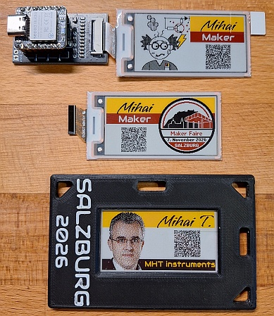

# Maker Badge

A small, educational Arduino project: an **e-paper display** in a **3D-printed case**
becomes a wearable **maker badge**. Because the content is fully programmable, the
same badge also works as a **digital business card** – show your name, a logo, a
picture or a QR code with your contact details.

It was built for hands-on workshops, so the hardware is plug-together, the code is
short and readable, and the display keeps showing its image even without power.



---

## Contents

- [Hardware](#hardware)
- [Assembly](#assembly)
- [Software setup](#software-setup)
  - [1. Arduino IDE](#1-arduino-ide)
  - [2. Board support for the XIAO nRF52840](#2-board-support-for-the-xiao-nrf52840)
  - [3. Libraries](#3-libraries)
  - [4. Two small edits in the Pervasive Displays libraries](#4-two-small-edits-in-the-pervasive-displays-libraries)
  - [5. Build and upload](#5-build-and-upload)
- [Good to know](#good-to-know)
- [License](#license)

---

## Hardware

| Part | Notes |
|---|---|
| **Seeed Studio XIAO nRF52840** | the controller |
| **ePaper Breakout Board for Seeed Studio XIAO** | the XIAO plugs straight into it |
| **Pervasive Displays 2.06" e-paper, E2206QS061** | 248 × 128 pixels, black / white / red / yellow |
| 3D-printed case | holds the stack together |

Having trouble getting hold of the hardware? Write me an email at
**[mht@mht-instruments.at](mailto:mht@mht-instruments.at)** and I'll try to help.

### Other Arduino boards

Any Arduino-compatible board with an **SPI bus** and **3.3 V** operation can drive the
display. The downside: instead of the neat stack-up, you need flying wires to bring
SPI, the control signals and the supply from your board to the ePaper breakout board.
You will also need a matching pin definition (see
[step 4b](#4b-add-the-xiao-nrf52840-pin-mapping)).

---

## Assembly

Assembly is straightforward:

1. **Controller:** plug the XIAO nRF52840 into the breakout board, with its **USB
   connector facing away from the display**.
2. **Display:** the display connector is **fragile** – handle it gently.
   1. Carefully lift the **black hinge** of the connector.
   2. Insert the display's flat cable **all the way in**, with the **display facing
      upwards**.
   3. Press the black hinge back down – this locks the flat cable in place.

See the photo for the correct orientation:
[photos/badge+templates.jpg](photos/badge+templates.jpg)

---

## Software setup

### 1. Arduino IDE

Install the [Arduino IDE](https://www.arduino.cc/en/software).
This project was built with **Arduino IDE 2.3.10**.

### 2. Board support for the XIAO nRF52840

Add the board support package for the XIAO nRF52840 as described in Seeed's guide:
[Getting Started with Seeed Studio XIAO nRF52840 Series | Seeed Studio Wiki](https://wiki.seeedstudio.com/XIAO_BLE/)

### 3. Libraries

Install these through the IDE's **Library Manager** (*Tools → Manage Libraries…*):

- **QRCode** by Richard Moore
- **PDLS_Basic** by Rei Vilo
- **PDLS_Common** by Rei Vilo

When you install the PDLS libraries, the IDE asks whether to install a number of
related libraries as well (including the display driver) – answer **Yes / Install all**.

### 4. Two small edits in the Pervasive Displays libraries

The Pervasive Displays libraries need two small additions to work with the XIAO
nRF52840 and with this project. The libraries are in your Arduino sketchbook folder
under `libraries/` (e.g. `Documents/Arduino/libraries/` on Windows and macOS).

> **Note:** updating these libraries through the Library Manager overwrites your
> changes – re-apply both edits after an update.

#### 4a. Give the sketch access to the frame buffer

The badge copies its template images straight into the display's frame buffer, so
`PDLS_Basic` needs a small getter.

**`PDLS_Basic/src/Screen_EPD.h`** – add the prototype to the `public:` section of
class `Screen_EPD` (for example right after `void flushFast();`):

```cpp
    uint8_t* getFrameBufferAddr();
```

**`PDLS_Basic/src/Screen_EPD.cpp`** – add the function, for example right after
`Screen_EPD::flushFast()`:

```cpp
uint8_t* Screen_EPD::getFrameBufferAddr()
{
    return s_newImage;
}
```

#### 4b. Add the XIAO nRF52840 pin mapping

**`PDLS_Common/src/hV_List_Boards.h`** – find the section **"Other boards"**
(`/// @name 2.2 Other boards`) and add:

```cpp
const pins_t boardXIAO_nRF52840 =
{
    .panelBusy = 5, ///< EXT3 and EXT3.1 pin 3 Red -> D10
    .panelDC = 3, ///< EXT3 and EXT3.1 pin 4 Orange -> D9
    .panelReset = 0, ///< EXT3 and EXT3.1 pin 5 Yellow -> D8
    .flashCS = NOT_CONNECTED, ///< EXT3 and EXT3.1 pin 8 Violet -> D7
    .panelCS = 1, ///< EXT3 and EXT3.1 pin 9 Grey -> D6
    .panelCSS = NOT_CONNECTED, ///< EXT3 and EXT3.1 pin 12 Grey2
    .flashCSS = NOT_CONNECTED, ///< EXT3 pin 20 or EXT3.1 pin 11 Black2
    .touchInt = NOT_CONNECTED, ///< EXT3-Touch pin 3 Red
    .touchReset = NOT_CONNECTED, ///< EXT3-Touch pin 4 Orange
    .panelPower = NOT_CONNECTED, ///< EXT4 pin 20 White power circuit -> D2
    .cardCS = NOT_CONNECTED, ///< External SD-card board
    .cardDetect = NOT_CONNECTED ///< External SD-card board
};
```

The numbers are the XIAO's GPIO numbers, not physical pin numbers.

**At this point, the sketch should compile.**

### 5. Build and upload

1. Open the sketch (`.ino`) in the Arduino IDE.
2. Select the board: *Tools → Board → Seeed nRF52 Boards → Seeed XIAO nRF52840*.
3. Connect the badge via USB and select its port under *Tools → Port*.
4. Click **Upload**.

---

## Good to know

- **A refresh takes about 15 seconds and the display flickers several times.**
  That is normal: the black / white / red / yellow e-paper has no fast-update mode,
  and the flashing is how the coloured particles get driven into place. Once done,
  the image stays – even without power.
- **Avoid unnecessary refreshes** – one `flush()` after drawing everything is enough;
  there is no need to clear the screen first.

---

## License

This project is released under the **MIT License** – see [LICENSE](LICENSE).

Some parts keep their original licenses (font structures from the Adafruit GFX
Library, and the bitmap fonts derived from Vujahday Script and Audiowide, which are
under the SIL Open Font License). See [THIRD_PARTY_NOTICES.md](THIRD_PARTY_NOTICES.md)
for details.

The Pervasive Displays libraries are **not** included in this repository; they are
installed separately through the Arduino IDE and are subject to their own license.
